<p align="center">
  
</p>

<h1 align="center">BookShelf</h1>

<p align="center">
  Il tuo scaffale, sempre con te. Un'app per tenere traccia di ogni lettura:<br/>
  libreria, sessioni, statistiche, citazioni e un riepilogo da condividere.
</p>

<p align="center">
  
  
  
  
  
</p>

<p align="center">
  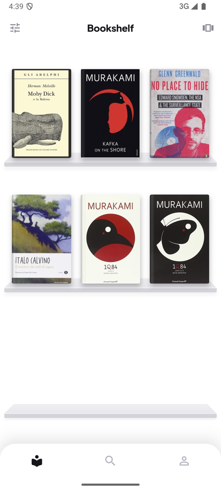
  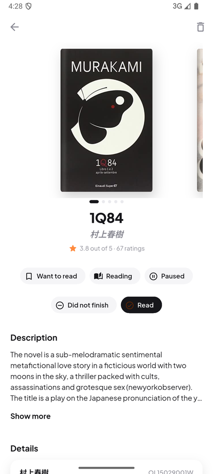
  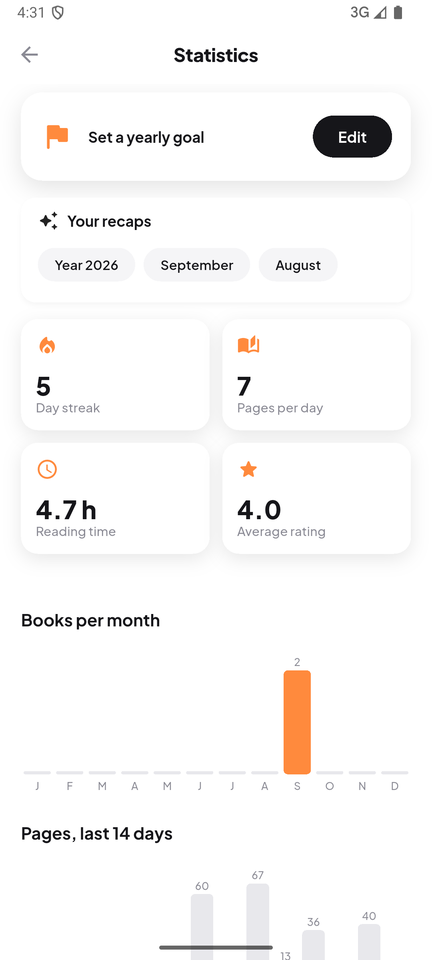
  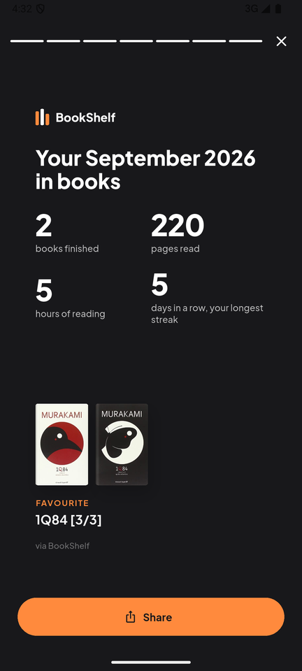
</p>

---

## Cosa fa

### 📚 La tua libreria
Cerca tra milioni di libri su [Open Library](https://openlibrary.org) o **scansiona il codice ISBN** con la fotocamera, poi mettili sul tuo scaffale.

- **Stati di lettura**: Da leggere, In lettura, In pausa, Abbandonato, Letto
- **Due viste**: copertine sui ripiani oppure una alla volta, a scorrimento
- **Scaffali personali** (tag liberi, colorati) e **filtri** per stato, scaffale, atmosfera, ritmo e prestiti
- **Scelta dell'edizione**: copertina, pagine, editore e ISBN dell'edizione che hai davvero in mano
- **Funziona offline**: la libreria resta sul telefono e le modifiche partono quando torna la rete
- **Import/export CSV** compatibile con Goodreads

<p>
  
  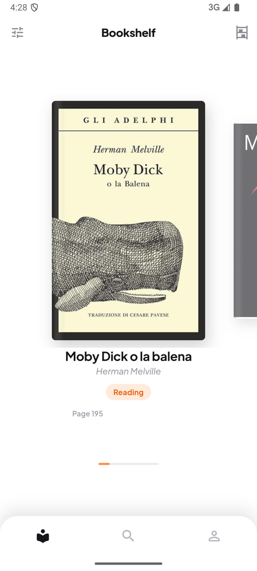
  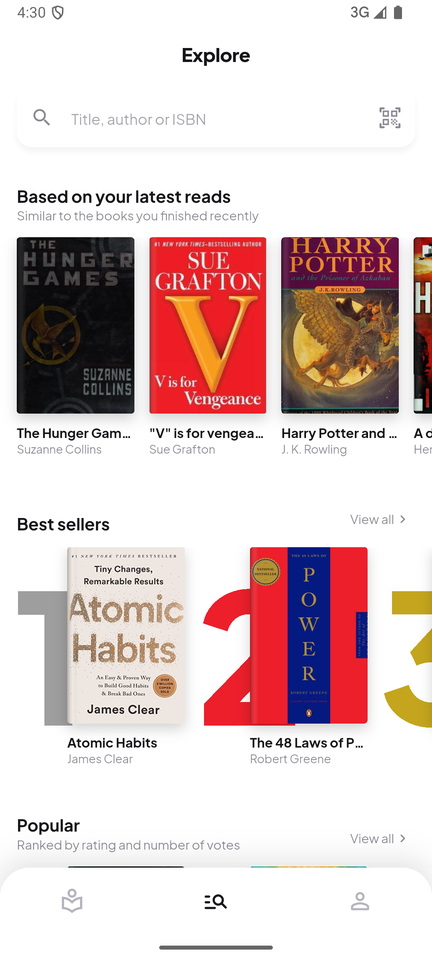
</p>

### 📖 Ogni libro, nel dettaglio
- **Progresso** in pagine o, per gli **audiolibri**, in ore e minuti; formato cartaceo, ebook o audiolibro
- **Sessioni di lettura** con cronometro, pagine e minuti, sfogliabili a pagine
- **Saghe**: volume e totale della saga, anche con **più volumi in un solo libro** (es. *1Q84*, volumi 1–2 e 3). Quando finisci un volume, l'app ti propone il seguito
- **Riletture**: la lettura finita resta nello storico e conta nelle statistiche
- **Atmosfera** in stile StoryGraph: fino a 3 umori (cupo, avventuroso, riflessivo…) e il ritmo
- **Citazioni**: salvale a mano o **fotografando la pagina** (testo riconosciuto sul telefono, senza servizi esterni)
- **Prestiti**: "l'ho prestato a…" o "preso in biblioteca, da restituire il…", con avviso il giorno della scadenza
- Valutazione, date di lettura e note personali

<p>
  
  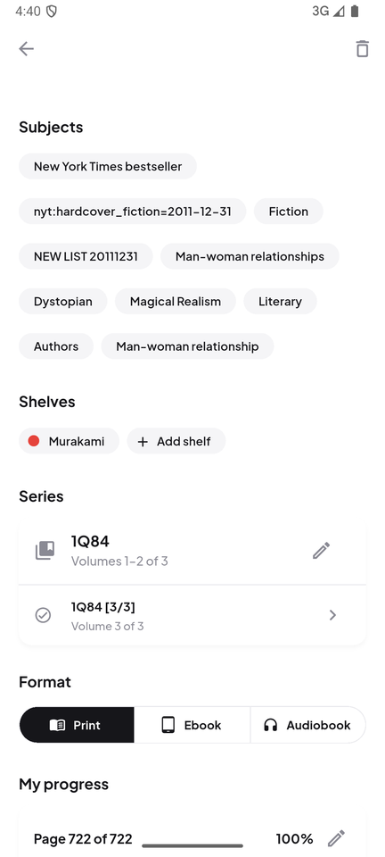
  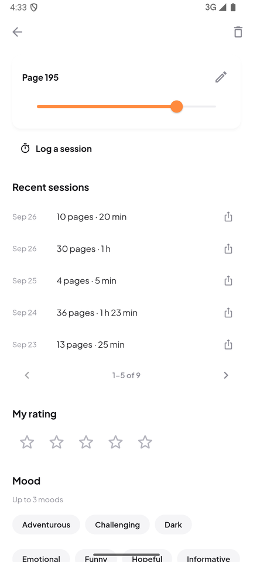
  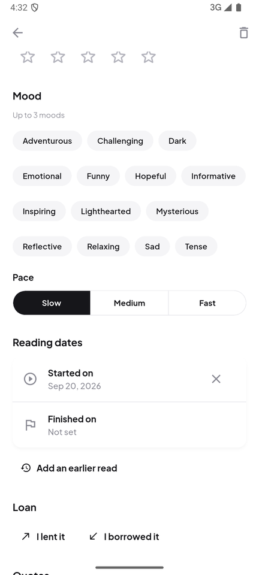
</p>

### 📊 Statistiche e riepiloghi
- **Obiettivo annuale**, serie di giorni consecutivi, pagine al giorno, tempo di lettura, media dei voti
- Libri finiti mese per mese e pagine degli ultimi 14 giorni; tocca un mese per il dettaglio
- **Riepilogo dell'anno e del mese** in stile *Wrapped*: schermate a tutto schermo (libri finiti, pagine e ore, abitudini, i migliori, i tuoi gusti) e una **card finale da condividere**

<p>
  
  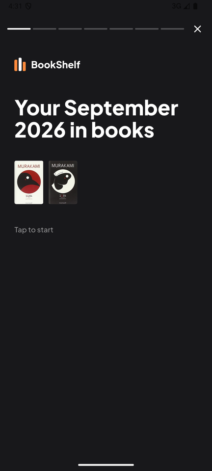
  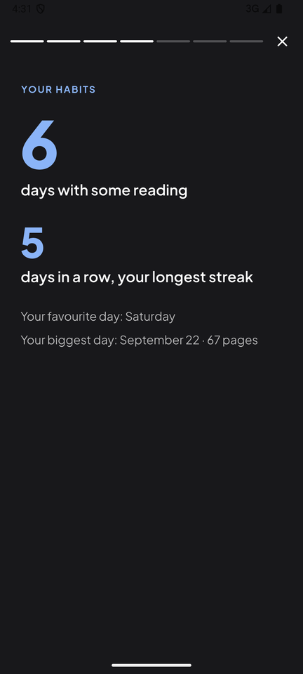
  
</p>

### 📤 Condivisione
Ogni sessione diventa un'immagine 1080×1920 pronta per le storie, in tre stili (**Stats**, **Poster**, **Foto**), con il luogo, una citazione (anche tra quelle salvate) e la foto del tuo angolo di lettura.

<p>
  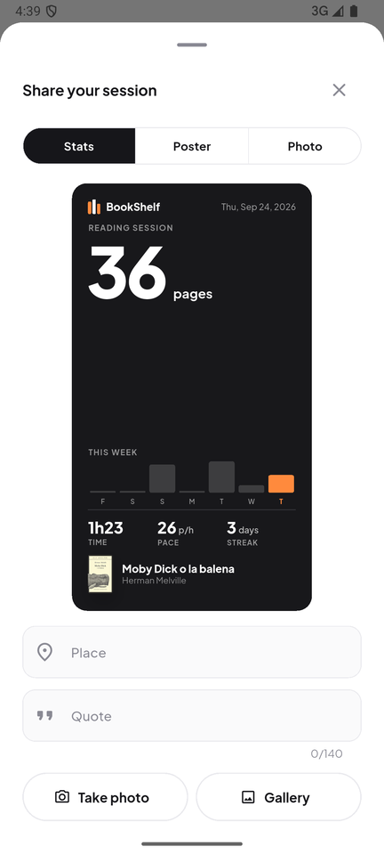
  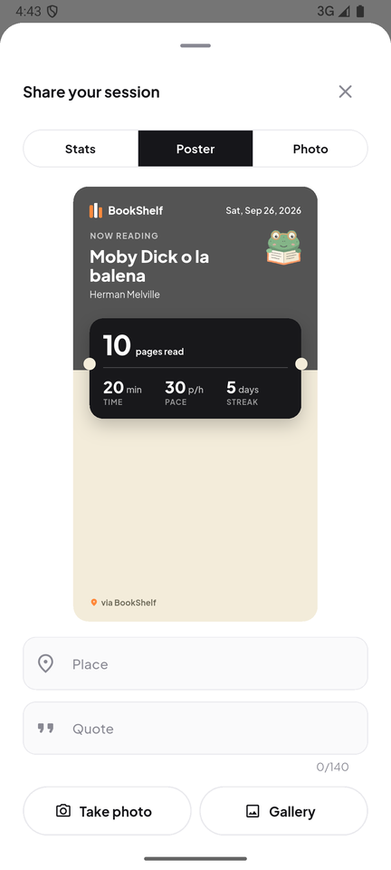
</p>

### 🔔 Promemoria e widget
- **Promemoria di lettura** giornaliero all'ora che scegli, che ti avvisa se stai per perdere la serie
- **Widget per la schermata Home** (Android), ridimensionabili:
  - *Lettura*: il libro in lettura, il progresso e la serie; grande mostra anche pagine rimaste, quando lo finisci al tuo ritmo e da quando lo leggi
  - *Libreria*: i libri in lettura, quanti ne hai su ogni scaffale, i prossimi da leggere e i tuoi scaffali
  - *Statistiche*: libri letti quest'anno e obiettivo, serie, pagine del mese e media al giorno
  - Toccando un libro si apre la sua scheda, le statistiche aprono la pagina delle statistiche

<p>
  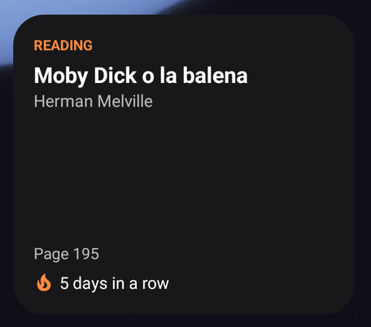
</p>

> Gli screenshot vengono da un emulatore Android in inglese; l'app è in italiano (predefinito) e inglese, con tema chiaro, scuro o di sistema.

---

## Tecnologie

| | |
|---|---|
| App | Flutter (Material 3), BLoC / Cubit, go_router, get_it |
| Backend | Supabase: autenticazione, Postgres con Row Level Security, storage per gli avatar |
| Dati sui libri | Open Library (ricerca, opere, edizioni, copertine) |
| Sul dispositivo | notifiche locali (`flutter_local_notifications`), widget (`home_widget`), riconoscimento del testo (Apple Vision / ML Kit), scanner ISBN (`mobile_scanner`) |
| Test | `flutter_test`, `bloc_test`, `mocktail` |

## Requisiti

- Flutter 3.47+ (stable), testato con Flutter 3.47.5
- Un progetto Supabase (il piano gratuito basta)

## Setup

### 1. Supabase

1. Crea un progetto su [supabase.com](https://supabase.com).
2. Apri **SQL Editor → New query**, incolla **tutto** [`supabase/schema.sql`](supabase/schema.sql) ed esegui. Crea tabelle (`profiles`, `user_books`, `reading_logs`, `book_quotes`), Row Level Security, trigger, il bucket `avatars` e la funzione `delete_my_account`. Lo script si può rilanciare.
3. **Authentication → URL Configuration → Redirect URLs**: aggiungi `io.supabase.bookshelf://login-callback/`. Serve per i link di conferma email e di recupero password, che riaprono l'app.
4. (Facoltativo) **Authentication → Providers → Email**: disattiva "Confirm email" se in sviluppo vuoi accedere subito dopo la registrazione.

#### Aggiornare un database esistente

Quando una nuova versione dell'app aggiunge colonne o tabelle, esegui [`supabase/update.sql`](supabase/update.sql) nel SQL Editor. Lo script:

- aggiunge solo ciò che manca (`add column if not exists`, `create table if not exists`, nuovi valori dell'enum);
- non cancella né riscrive righe, e lascia com'erano le policy che hai già;
- si può eseguire quante volte vuoi;
- alla fine mostra una tabella con colonne, tabelle, policy e valori dell'enum presenti.

Se il database non è aggiornato, l'app lo dice esplicitamente ("Il database non è aggiornato…") invece di un errore generico.

### 2. Credenziali

```bash
cp .env.example .env
```

Poi compila `.env` (Supabase Dashboard → **Project Settings → API**):

```
SUPABASE_URL=https://<project-ref>.supabase.co
SUPABASE_ANON_KEY=<anon / publishable key>
```

`.env` è nel `.gitignore` e non va committato; nessun segreto è scritto nel codice. Non usare mai la chiave `service_role` nell'app. Se `.env` manca, l'app mostra una schermata di configurazione mancante invece di chiudersi.

### 3. Avvio

```bash
flutter pub get
flutter run
```

Non serve `build_runner`: i modelli sono classi scritte a mano con `Equatable`. Le traduzioni (`lib/l10n/gen/`) sono generate da `flutter pub get` / `flutter gen-l10n` a partire dai file `.arb`.

### Comandi utili

```bash
flutter analyze      # analisi statica
flutter test         # unit e widget test
flutter gen-l10n     # rigenera le traduzioni dopo aver modificato gli .arb
```

## Architettura

Organizzata per funzionalità, ognuna con tre livelli. Le schermate dipendono solo dai Bloc, i Bloc da repository astratti.

```
lib/
  core/
    config/    .env, costanti (User-Agent, redirect URL)
    di/        get_it: datasource, repository, servizi, bloc
    errors/    Failure, mapError (Dio / Supabase / rete -> Failure), messaggi localizzati
    router/    go_router, guardia di autenticazione, shell con la barra in basso
    theme/     colori, tipografia, tema Material 3 chiaro e scuro
    utils/     RequestStatus, transformer dei Bloc, formattazione di minuti e copertine
    widgets/   copertine, dialog, stati vuoti e di errore, grafici
  features/
    auth/          accesso, registrazione, recupero password, schermata di benvenuto
    library/       libreria, scaffali, filtri, cache offline, regole di dominio (UserBook)
    search/        ricerca ed esplorazione su Open Library, edizioni, consigli
    scanner/       scansione ISBN
    book_details/  dettaglio del libro con tutte le sue sezioni, card di condivisione
    quotes/        citazioni e riconoscimento del testo da foto
    stats/         registro delle sessioni, statistiche, obiettivo annuale
    recap/         riepilogo dell'anno e del mese
    reminders/     promemoria di lettura e scadenza dei prestiti (notifiche locali)
    home_widget/   dati per il widget della schermata Home
    library_io/    import/export CSV (formato Goodreads)
    profile/       profilo, avatar, tema, eliminazione dell'account
  l10n/            app_it.arb (modello), app_en.arb, codice generato in gen/
supabase/
  schema.sql       progetto nuovo
  update.sql       aggiornamento di un database esistente
```

Ogni funzionalità ha `data` (datasource, repository, mapper), `domain` (entità, repository astratti, casi d'uso) e `presentation` (bloc/cubit, pagine, widget).

### Flusso dei dati

- **Errori**: i repository intercettano ogni eccezione e rilanciano un `Failure(code)`; la UI lo traduce in un messaggio localizzato. Stati espliciti `initial / loading / success / failure`.
- **Libreria**: `LibraryRepositoryImpl` tiene una copia in memoria e su file (per l'uso offline) ed espone uno `Stream` delle modifiche. `LibraryBloc` la segue, quindi ciò che cambi nel dettaglio compare subito ovunque. Le modifiche fatte offline vengono messe in coda e inviate al ritorno della rete.
- **Dettaglio**: `BookDetailsBloc` gestisce sia i libri in libreria sia l'anteprima dei risultati di ricerca. Le modifiche sono ottimistiche, con ripristino in caso di errore; le regole (es. "letto" porta il segnalibro all'ultima pagina) stanno in `UserBook`.
- **Notifiche**: sono locali, programmate sul telefono. I promemoria vengono ricalcolati quando apri l'app o registri una sessione, così il testo parla della tua serie reale.

## Identità visiva

- Un solo carattere, **Plus Jakarta Sans** (variabile), in `core/theme/app_typography.dart`
- Colori in `core/theme/app_colors.dart`: inchiostro scuro e arancio come accento
- Copertine "in tela" con titolo quando manca l'immagine (`core/widgets/book_cover.dart`)
- Marchio con tre dorsi di libri (`core/widgets/bookshelf_mark.dart`) e la rana che legge come mascotte

I font sono distribuiti con licenza SIL OFL (testi in `assets/fonts/licenses/`).

## Note tecniche

- **Open Library**: `search.json`, `works/{id}.json`, edizioni e `covers.openlibrary.org`, con un `User-Agent` descrittivo (`AppConfig.userAgent`). Se pubblichi l'app, aggiungi un contatto come chiede Open Library.
- **Eliminazione dell'account**: il client non può cancellare la propria riga in `auth.users`, quindi `schema.sql` definisce la funzione `delete_my_account()` (`security definer`, solo per utenti autenticati). L'app rimuove prima gli avatar, poi chiama la funzione; `on delete cascade` elimina il resto. Non serve nessuna Edge Function.
- **Accesso con Apple**: OAuth di Supabase nel browser di sistema, con ritorno all'app sul deep link `io.supabase.bookshelf://login-callback/`. Il profilo prende il nome condiviso da Apple (trigger `handle_new_user`, aggiornato anche in `update.sql`). Per attivarlo:
  1. Supabase → Authentication → URL Configuration: aggiungi `io.supabase.bookshelf://login-callback/` ai *Redirect URLs*.
  2. In Apple Developer crea un *Services ID* con *Sign in with Apple*, dominio `<progetto>.supabase.co` e return URL `https://<progetto>.supabase.co/auth/v1/callback`, più una chiave *Sign in with Apple*; inserisci Services ID, Team ID, Key ID e chiave in Supabase → Authentication → Providers → Apple.
  3. Per nascondere il pulsante imposta `AppConfig.socialLoginEnabled = false`.
- **Android**: deep link `io.supabase.bookshelf://login-callback`; notifiche (`POST_NOTIFICATIONS`, `RECEIVE_BOOT_COMPLETED`, desugaring attivo); ML Kit per il testo delle citazioni (`MainActivity.kt`); widget in `ReadingWidgetProvider.kt` e `res/layout/reading_widget.xml`; icona adattiva.
- **iOS**: URL scheme `io.supabase.bookshelf`; permessi per fotocamera e foto; Apple Vision per il testo delle citazioni e delegate delle notifiche in `AppDelegate.swift`. Il widget è pronto in `ios/ReadingWidget/` ma non è collegato al progetto, perché richiede un App Group e quindi un account Apple Developer a pagamento (istruzioni in `ios/ReadingWidget/README.md`).
- Il progetto è pensato per Android e iOS: il target web non è supportato.

## Test

`flutter test` esegue unit test e widget test su:

- i Bloc e i Cubit (autenticazione, libreria, ricerca, dettaglio del libro, statistiche)
- le regole di dominio: stati, riletture, audiolibri, saghe con più volumi, prestiti, statistiche, riepiloghi
- repository, cache offline, mapper, import/export CSV e mapping degli errori
- promemoria, avvisi dei prestiti e dati del widget, con uno scheduler finto al posto delle notifiche vere
- le schermate e i fogli principali, comprese le card di condivisione (niente overflow nemmeno con testi lunghi)
